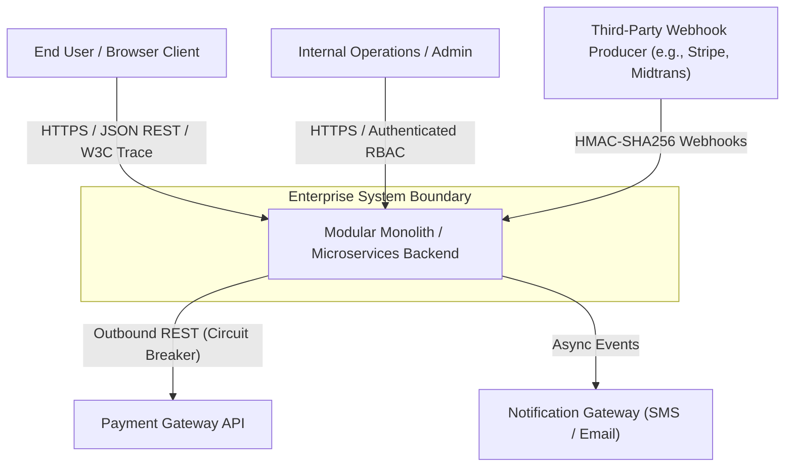
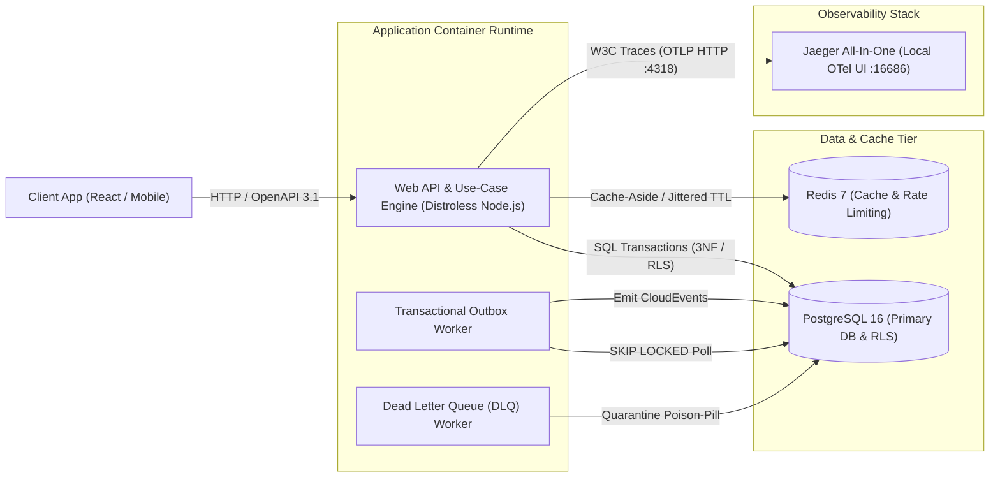
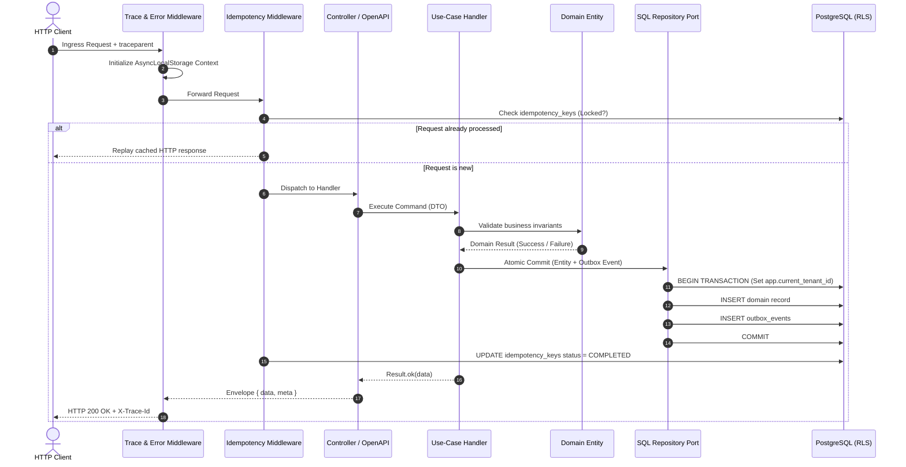
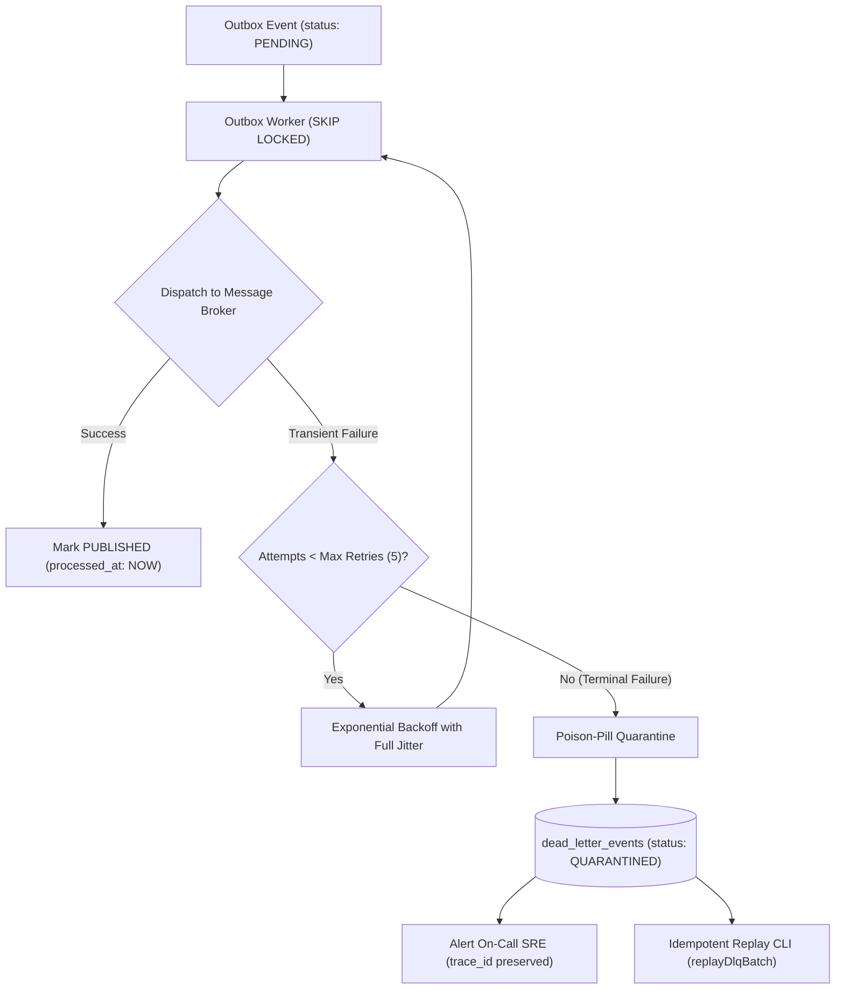

# System Architecture Overview (C4 Model & Event Flows)

This document provides visual Architecture-as-Code for developers and AI agents operating within the **`.agents/` Enterprise Production Framework**.

---

## 1. C4 Level 1: System Context Diagram

Visualizes high-level system boundaries, user actors, and external third-party integrations.

---

## 2. C4 Level 2: Container Diagram

Illustrates the runtime topology, local development infrastructure (`docker-compose.yml`), transactional data stores, and observability pipelines.

---

## 3. C4 Level 3: Clean Architecture Component Flow

Detailed end-to-end request lifecycle through the Clean Architecture layers, enforcing single responsibility and strict mock boundaries.

---

## 4. Resilient Asynchronous Event Life Cycle

Diagram of the Transactional Outbox, Retry with Exponential Backoff, and Poison-Pill DLQ Quarantine.

